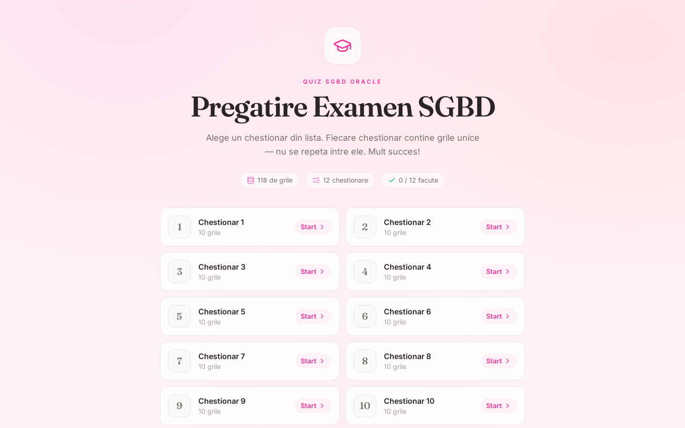
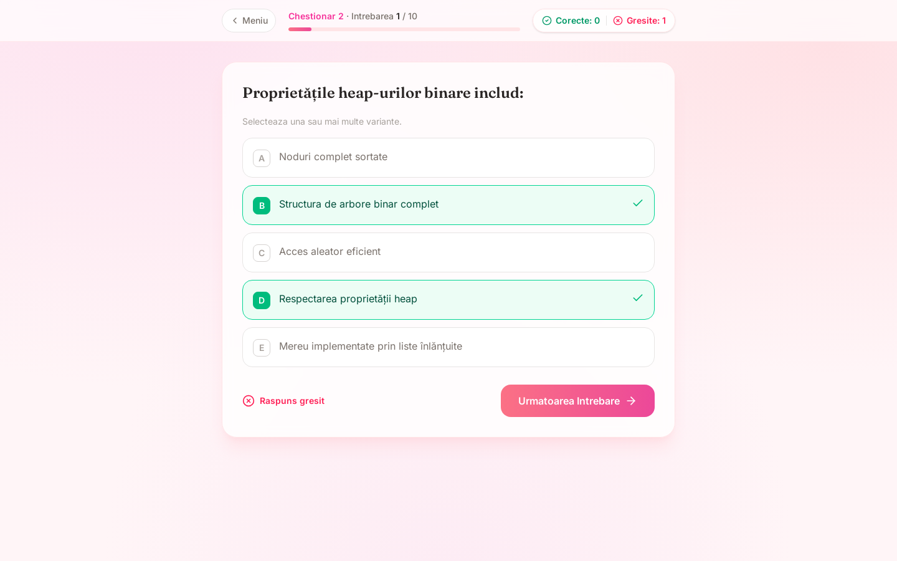

# SGBD Exam Prep

Quiz app I built to study for the Database Management Systems (SGBD) exam at university. It covers Oracle SQL and PL/SQL: 118 multiple-choice questions split into 12 fixed quizzes, with code snippets shown the way they would look in an editor.

Live: [grile-sgbd.vercel.app](https://grile-sgbd.vercel.app)





## How it works

- Pick a quiz from the list. Each one has its own set of questions, and no question appears in two quizzes.
- Questions can have more than one correct answer. After you check, your correct picks turn green, wrong picks turn red, and any correct answers you missed are highlighted.
- A counter at the top tracks correct and wrong answers. You pass a quiz with at least half the answers right.
- Results are saved in `localStorage`, so the list shows which quizzes you've already passed.
- SQL and PL/SQL snippets get syntax highlighting from a small tokenizer in `src/components/CodeBlock.jsx`, without an external library.

## Stack

React 19, Vite, Tailwind CSS 4, lucide-react. No backend: the questions are bundled as JSON.

## Running locally

```bash
npm install
npm run dev
```

## Data

- `src/data/questions.json` holds every question, its options, the correct answers and an optional code snippet.
- `src/data/sets.json` decides which questions go into which quiz. It's generated once by `scripts/generate-sets.mjs`, which shuffles with a fixed seed, so the quizzes stay the same between visits and saved progress keeps matching. Re-run the script only if you add questions and want new quizzes.
- `resurse grile/` has the PDFs the questions were taken from.
